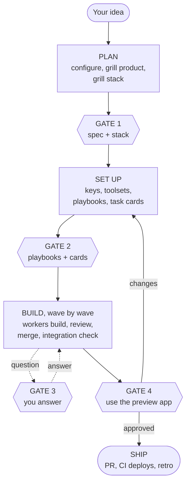

# MAD: Multi-Agent Development workflow

[](https://www.npmjs.com/package/mad-workflow)
[](LICENSE)

MAD turns one idea into a coordinated team of AI agents. A coordinator grills you on what to build and how, writes a spec and small task cards, and then runs workers in parallel, each in its own git worktree, on Claude Code, Codex or OpenCode. You decide at four gates. Between them, the agents work on their own.

**Docs with diagram:** https://gottipx.github.io/mad-workflow/

## Quick install

Needs [Node.js](https://nodejs.org) 18.17+, git, and [Orca](https://orca.dev) to run the workers. Works on macOS, Linux and Windows.

```bash
npm install -g mad-workflow
```

## Quick start

```bash
cd my-project
mad init
```

Then start your agent in that folder, inside Orca, on a high-end model:

| Agent | Start MAD with |
|---|---|
| Claude Code | `/mad` |
| Codex | `$mad`, or ask "start MAD" |
| OpenCode | ask "start MAD" |

The agent you start MAD in becomes the coordinator. It asks you which agent and model each role should use, then walks you through the rest.

## How it works



1. **Plan.** Pick a model for each role. The coordinator grills you on the product (`SPEC.md`) and on the stack and toolchain (`STACK.md`). **Gate 1.**
2. **Set up.** You create accounts and keys; the coordinator sets up and checks every tool, then writes agent playbooks and task cards. **Gate 2**, the most important one.
3. **Build.** An architect lays the shared contracts first. Then, wave by wave, developers build their cards in parallel worktrees, high-risk cards get a separate reviewer, and the coordinator merges and runs an integration check. Questions the spec doesn't answer come to you: **Gate 3.**
4. **Ship.** You use the preview app. **Gate 4.** On approval the run becomes a PR, CI deploys to production, and lessons go back into the rules.

## What you decide

| When | You decide |
|---|---|
| Start | Agent, model and effort for each role, parallel workers, review policy |
| Gate 1 | What to build, and with which stack |
| Gate 2 | The rules (playbooks) and how the work is split (task cards) |
| Gate 3 | Questions the spec doesn't answer, tasks that failed review twice, commands that failed 3 times |
| Gate 4 | Whether the app is right |

Each role can run on a different agent:

```yaml
coordinator: { agent: claude, model: claude-opus-5-5, effort: high }
roles:
  architect: { agent: claude,   model: claude-opus-5-5,   effort: medium }
  developer: { agent: claude,   model: claude-sonnet-5-5, effort: medium }
  reviewer:  { agent: codex,    model: gpt-6.1-sol,       effort: low }
review: risky              # a separate reviewer only for high-risk cards
```

## Commands

```
mad init [folder]     set up MAD in a folder (default: current folder)
mad update [folder]   update MAD's own files in a project, keep everything else
mad clean [--dry-run] remove finished task worktrees and branches
mad models            list installed agents and the models each offers
mad version           show the installed version
```

## What `mad init` adds to a project

```
.claude/skills/mad/       the MAD skill for Claude Code and OpenCode
.agents/skills/mad/       the same skill for Codex
AGENTS.md                 a short pointer to the skill
mad/
  config/mad.yaml         coordinator, models per role, limits, review policy, toolchain
  roles/                  architect, developer, reviewer
  kit/                    templates and helper scripts (replaced by mad update)
```

During a run, MAD adds `SPEC.md`, `STACK.md`, `AGENTS.md` (worker rules), `MAP.md`, `RUN.md`, `playbooks/`, `tasks/` and `dispatch/` to `mad/`. The software itself goes into `app/`.

## Safety and cost

- **Keys:** agents get dev projects only. Production keys live only in CI. `mad init` keeps `.env` out of git.
- **Tokens:** cheaper models for developers and reviewers, exact read lists on every card, a short code map instead of exploring, tests run once at the end, and a separate reviewer only for high-risk cards.
- **Cleanup:** finished task worktrees and branches are removed as soon as their work is merged.

## Status

MAD is tested with Claude Code as coordinator on macOS. Codex and OpenCode as coordinator, other Orca agents as workers, and Windows and Linux should work but haven't been tried yet. Reports are welcome in the [issues](https://github.com/gottipx/mad-workflow/issues).

## Developing MAD

```
kit/                      the workflow, copied into projects by mad init
  skill/SKILL.md          the MAD skill the coordinator follows
  templates/              SPEC, STACK, AGENTS, MAP, RUN, task card, playbooks, config
  bin/                    assemble.mjs, cleanup.mjs, models.mjs
  roles/                  architect, developer, reviewer
package/                  the npm package
  bin/mad.mjs             the mad command
  scripts/                sync-kit (runs before packing), install-local
docs/index.html           the docs page (GitHub Pages)
```

Install your local version globally with `cd package && npm run install-local`, then run `mad update` in a test project.

To release: bump `version` in `package/package.json`, then `cd package && npm publish`. Packing copies `kit/` and `LICENSE` into the package first.

## License

[MIT](LICENSE)
